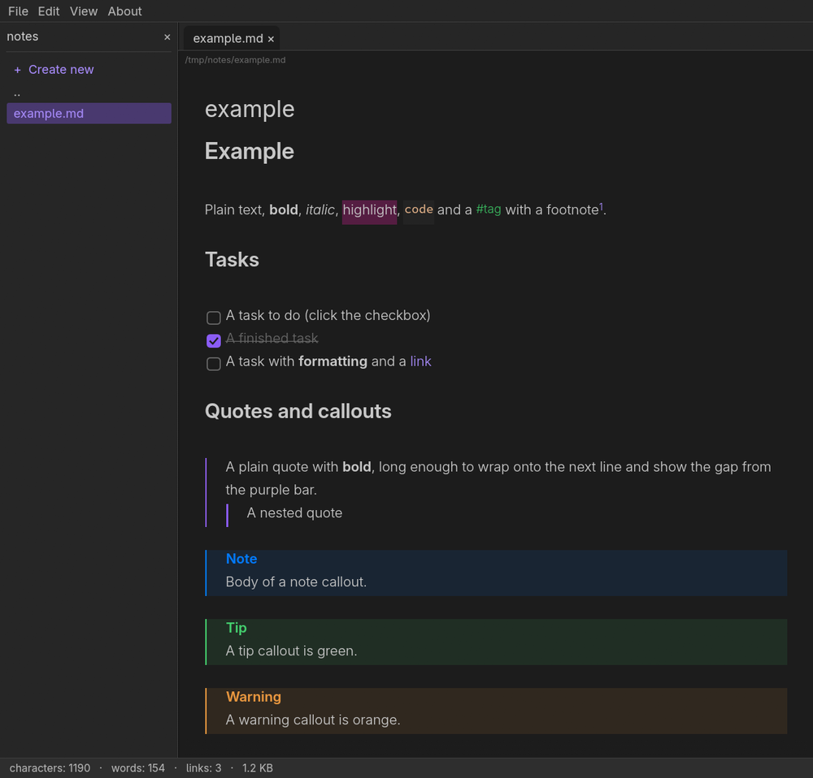

# MDEdit

A fast, minimal **WYSIWYG Markdown editor** written in Rust with [egui](https://github.com/emilk/egui). It works like Obsidian's live preview: markers are hidden everywhere except on the line with the cursor, so `# Title` becomes a heading as soon as you move away from it. Dark mode only. The UI is available in 23 languages (choose one in Preferences).

Polish version: [README.pl.md](README.pl.md).



## Features

- **Live preview** of headings, bold, italic, strikethrough, `==highlight==`, inline code and code
  blocks, links, `[[wiki links]]`, `#tags`, footnotes, `%%comments%%`, horizontal rules, front matter.
- **Lists and tasks** with hanging indents, clickable checkboxes, Enter continues a list, Tab / Shift+Tab indent.
- **Quotes and callouts** (`> [!note]`, `tip`, `warning`, `danger`, `question`, …), **tables** with column alignment.
- **Formulas**: `$…$`, `\(…\)`, `$$…$$`, `\[…\]`, including `\boxed{}` and `\text{}`, rendered as Unicode.
- **Images**: from files, embedded as `data:` base64, `![[embeds]]`, `` widths.
  Ctrl+V with an image in the clipboard embeds it as a JPEG (85%, max 1200 px wide), or saves a WebP next to the document.
- **Tabs, find / replace, undo / redo** (10 steps), recent files, a simple **file panel** (create, open, delete to trash).
- Formatting shortcuts that also toggle the selection (Ctrl+B, Ctrl+I, …), Ctrl+scroll zooms the font.
- **Single instance**: running `mdedit file.md` again opens the file in a new tab of the running window.
- Linux primary selection: select text, paste with the middle mouse button or Shift+Insert.
- Defaults from Obsidian's dark theme: Inter (text) and Source Code Pro (code), both embedded;
  UI in the desktop font (KDE / GNOME settings, Noto Sans 10 as fallback).
- Binary and very large files (over 5 MB) are refused instead of freezing the editor.
- Windows line endings (CRLF) are kept when saving. Ctrl+click opens only web and mail links, and never programs or scripts.

`examples/example.md` (English) and `examples/przyklad.md` (Polish) show every supported element.

## Build and run

Requires Rust 1.95 or newer (edition 2024).

```sh
cargo run --release -- examples/example.md
# or
cargo build --release && ./target/release/mdedit notes.md
cargo test --release
```

On Linux you need the usual windowing libraries (Wayland and/or X11, `libxkbcommon`) and, for the file dialogs, an XDG desktop portal (KDE, GNOME, …). Clipboard images on Wayland use `wl-clipboard` protocols built into the binary.

### Launcher entry and icon

```sh
./packaging/install.sh
```

installs `mdedit.desktop` and the icon for the current user. On Wayland the taskbar icon comes from that file (it is matched by the app id `mdedit`); on X11 and Windows the icon is also embedded in the window.

## Keyboard shortcuts

| Action | Keys |
| --- | --- |
| New / Open / Save / Save as | Ctrl+N / Ctrl+O / Ctrl+S / Ctrl+Shift+S |
| Save all | Ctrl+Shift+Alt+S (Ctrl+Shift+Cmd+S on macOS)¹ |
| Close / Close all / Exit | Ctrl+W / Ctrl+Shift+W / Ctrl+Q |
| Undo / Redo | Ctrl+Z / Ctrl+Y, Ctrl+Shift+Z |
| Copy / Paste (text or image) | Ctrl+C / Ctrl+V |
| Paste selection (primary) | Middle click, Shift+Insert |
| Find / Replace | Ctrl+F |
| Insert image from file | Ctrl+Shift+I |
| File panel | Ctrl+Shift+F |
| Preferences / About | Ctrl+, / F1 |
| Bold / Italic / Strikethrough | Ctrl+B / Ctrl+I / Ctrl+D |
| Inline code / Highlight / Link | Ctrl+E / Ctrl+Shift+H / Ctrl+K |
| Heading 1–6 / normal text | Ctrl+1 … Ctrl+6 / Ctrl+0 |
| Bullet list / Task / Quote | Ctrl+Shift+L / Ctrl+L / Ctrl+Shift+Q |
| Open link or jump to footnote | Ctrl+click |
| Change font size | Ctrl+scroll |
| Indent list item | Tab / Shift+Tab |

¹ egui does not report the Super/Meta key on Linux and Windows, so Alt stands in for it.

## Preferences

Edit → Preferences… (Ctrl+,): editor font, text / bold / code weight, text gamma, font size, line height,
how pasted images are stored and the language. **Reset** restores the default font settings (Inter, weights
300 / 600 / 400, gamma 0.80, 17 px, line height 1.65). View has toggles for the readable line length,
line numbers, inline title and the file panel.

Settings are stored in `~/.config/mdedit/config`, recent files in `~/.config/mdedit/recent`.

## Project layout

| File | Purpose |
| --- | --- |
| `src/main.rs` | entry point, single-instance socket, window icon |
| `src/app.rs` | the application: menus, tabs, editor, dialogs, undo, settings |
| `src/md.rs` | Markdown to styled text layout and decorations |
| `src/latex.rs` | LaTeX math to Unicode |
| `src/files.rs` | file panel |
| `src/fonts.rs` | font loading (embedded Inter / Source Code Pro, system fonts via fontconfig) |
| `src/base64.rs`, `src/i18n.rs` | base64 for embedded images, English / Polish strings |

## License and credits

MIT, see [LICENSE](LICENSE). Created by ORDIGITAL Adam Mateusz Brożyński.

Code written with the help of Claude Opus 5.5 and Claude Sonnet 5.5 (Anthropic).

Fonts: [Inter](https://github.com/rsms/inter) and [Source Code Pro](https://github.com/adobe-fonts/source-code-pro),
both under the SIL Open Font License 1.1 (see `assets/`). Colors and proportions follow the default dark theme of Obsidian; this project is not affiliated with Obsidian.
