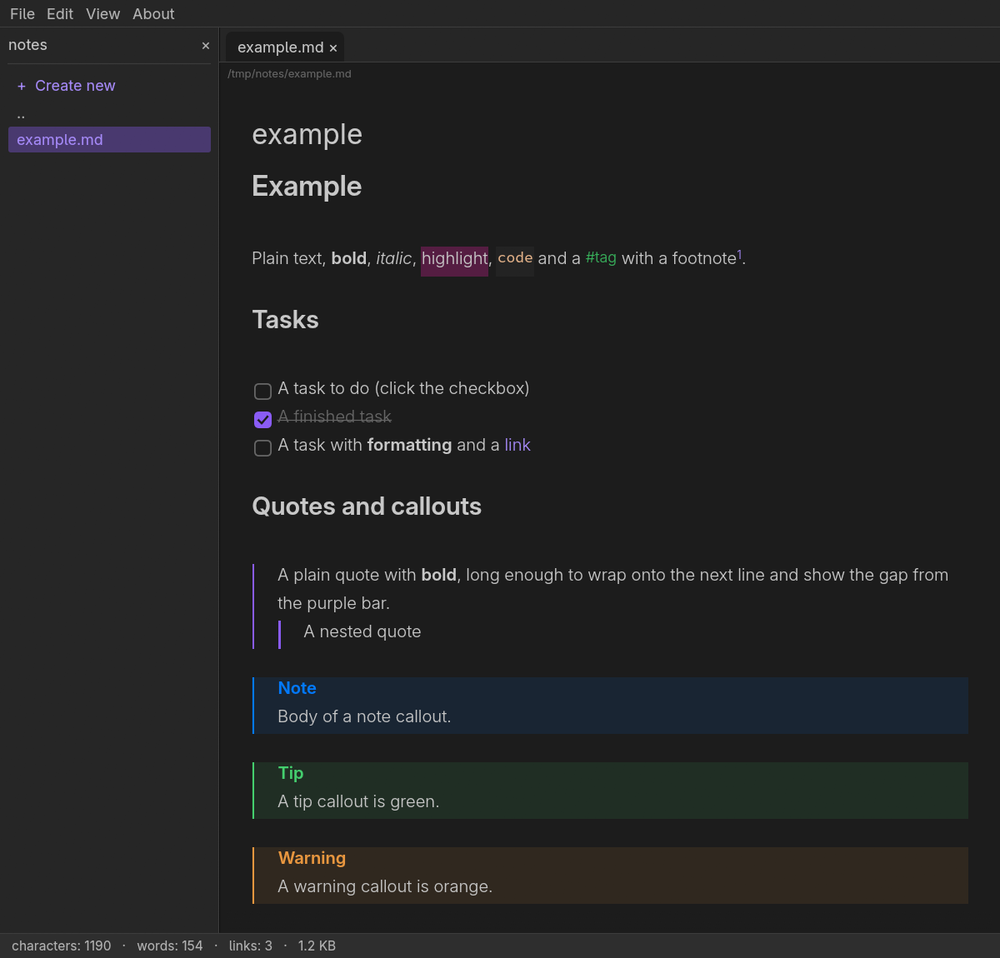

# MDEdit

Szybki, minimalistyczny **edytor Markdown typu WYSIWYG** napisany w Rust z użyciem [egui](https://github.com/emilk/egui). Działa jak podgląd na żywo w Obsidianie: znaczniki są ukryte wszędzie poza linią, w której stoi kursor, więc `# Tytuł` staje się nagłówkiem, gdy tylko przesuniesz kursor dalej. Tylko ciemny motyw. Interfejs jest dostępny w 23 językach (wybór w Preferencjach).



## Funkcje

- Cztery szerokości widoku: **Wąski, Średni, Szeroki, Pełny**, przełączane przez **F2**. Nieco większa czcionka w plikach kodu.
- Przeciąganie plików na okno otwiera je w zakładkach. Okno otwierania domyślnie pokazuje wszystkie pliki; filtr Markdown można wybrać ręcznie. Na Linuksie aplikacja preferuje X11/XWayland, gdy jest dostępny — winit 0.30 nie odbiera upuszczanych plików w natywnym Waylandzie.

- **Pasek formatowania pod zakładkami**: nagłówki 1–6, zwykły tekst, style, linki, listy, zadania, cytaty i obrazy.
- **Ctrl+Shift+K** tworzy nowy plik Markdown w folderze bieżącego dokumentu i linkuje do niego zaznaczony tekst. Enter lub Zapisz potwierdza; istniejące pliki nie są nadpisywane.
- **Podgląd na żywo** nagłówków, pogrubienia, kursywy, przekreślenia, `==wyróżnienia==`, kodu w linii i bloków kodu, linków, `[[linków wiki]]`, `#tagów`, przypisów, `%%komentarzy%%`, linii poziomych i nagłówka YAML.
- **Listy i zadania** z wiszącym wcięciem, klikalne pola wyboru. Numeracja aktualizuje się automatycznie. Enter dodaje kolejny punkt, Shift+Enter nową linię w tym samym punkcie, a Tab i Shift+Tab zmieniają poziom zagnieżdżenia.
- **Cytaty i callouty** (`> [!note]`, `tip`, `warning`, `danger`, `question` itd.) oraz **tabele** z wyrównaniem kolumn. Długi tekst w komórkach zawija się do nowych linii.
- **Wzory**: `$…$`, `\(…\)`, `$$…$$`, `\[…\]`, także `\boxed{}` i `\text{}`, wyświetlane jako Unicode.
- **Obrazy**: z plików, osadzone jako base64 `data:`, `![[embedy]]` i szerokości ``. Ctrl+V z obrazem w schowku osadza go jako JPEG (85%, maks. 1200 px szerokości) albo zapisuje WebP obok dokumentu.
- **Karty, szukaj i zamień, cofnij/ponów** (10 kroków), ostatnie pliki, **panel plików** (tworzenie, otwieranie, usuwanie do kosza).
- Skróty formatowania, które także zmieniają zaznaczony tekst (Ctrl+B, Ctrl+I itd.). Ctrl+kółko myszy zmienia rozmiar czcionki.
- **Jedna instancja** (Linux): ponowne uruchomienie `mdedit plik.md` otwiera plik w nowej karcie działającego okna.
- Schowek zaznaczenia w Linuksie: zaznacz tekst, wklej środkowym przyciskiem myszy albo Shift+Insert.
- Domyślne ustawienia z ciemnego motywu Obsidiana: czcionki Inter (tekst) i Source Code Pro (kod), obie wbudowane. Interfejs używa czcionki systemowej (ustawienia KDE / GNOME, zapasowo Noto Sans 10).
- Pliki konfiguracyjne są pokazywane jako kolorowany tekst, zależnie od rozszerzenia: XML, TOML, JSON, YAML, INI/CFG/CONF i `.env`. Kolorowane są także skrypty Bash (`.sh`, `.bash`) oraz pliki startowe powłoki, np. `.bashrc` i `.profile`.
- **Kolorowanie kodu** HTML, CSS, PHP, Python, Rust, C, C++, Go i JavaScript, także HTML/CSS/JS osadzonych w PHP i obsługiwanych bloków kodu w Markdown. Analiza działa w tle i wykorzystuje niezmienione linie.
  Bardzo długie linie kodu (ponad 256 KiB) pozostają zwykłym tekstem. [Architektura i pomiary](docs/syntax-highlighting.md).
- Pliki binarne i bardzo duże (ponad 5 MB) są odrzucane, zamiast zamrażać edytor.
- Końce linii Windows (CRLF) są zachowywane przy zapisie. Ctrl+klik otwiera tylko linki internetowe i pocztowe, nigdy programów ani skryptów.

`examples/example.md` (po angielsku) i `examples/przyklad.md` (po polsku) pokazują wszystkie obsługiwane elementy.

## Budowanie i uruchamianie

Wymagany Rust 1.95 lub nowszy (edycja 2024).

```sh
cargo run --release -- examples/example.md
# albo
cargo build --release && ./target/release/mdedit notatki.md
cargo test --release
```

W Linuksie potrzebne są zwykłe biblioteki okienkowe (Wayland i/lub X11, `libxkbcommon`) oraz, dla okien wyboru plików, portal XDG (KDE, GNOME itd.). Obrazy ze schowka na Wayland korzystają z protokołów `wl-clipboard` wbudowanych w program.

### Wpis w menu i ikona

```sh
./packaging/install.sh
```

instaluje dla bieżącego użytkownika `mdedit.desktop` i ikonę. Na Wayland ikona na pasku zadań pochodzi z tego pliku (dopasowanie po identyfikatorze aplikacji `mdedit`); na X11 i Windows ikona jest też osadzona w oknie.

## Skróty klawiszowe

| Akcja | Klawisze |
| --- | --- |
| Zmiana szerokości widoku | F2 |
| Nowy / Otwórz / Zapisz / Zapisz jako | Ctrl+N (Ctrl+T) / Ctrl+O / Ctrl+S / Ctrl+Shift+S |
| Zapisz wszystko | Ctrl+Shift+Alt+S (Ctrl+Shift+Cmd+S na macOS)¹ |
| Zamknij / Zamknij wszystko / Wyjście | Ctrl+W / Ctrl+Shift+W / Ctrl+Q |
| Cofnij / Ponów | Ctrl+Z / Ctrl+Y, Ctrl+Shift+Z |
| Kopiuj / Wklej (tekst lub obraz) | Ctrl+C / Ctrl+V |
| Wklej zaznaczenie (schowek zaznaczenia) | Środkowy przycisk myszy, Shift+Insert |
| Szukaj / Zamień | Ctrl+F |
| Wstaw obraz z pliku | Ctrl+Shift+I |
| Panel plików | Ctrl+Shift+F |
| Preferencje / O programie | Ctrl+, / F1 |
| Pogrubienie / Kursywa / Przekreślenie | Ctrl+B / Ctrl+I / Ctrl+D |
| Kod w linii / Wyróżnienie / Link | Ctrl+E / Ctrl+Shift+H / Ctrl+K |
| Nowa strona z linkiem | Ctrl+Shift+K |
| Nagłówek 1–6 / zwykły tekst | Ctrl+1 … Ctrl+6 / Ctrl+0 |
| Lista punktowana / zadanie / cytat | Ctrl+Shift+L / Ctrl+L / Ctrl+Shift+Q |
| Otwórz link lub przejdź do przypisu | Ctrl+klik |
| Zmiana rozmiaru czcionki | Ctrl+kółko myszy |
| Nowy punkt / linia w punkcie | Enter / Shift+Enter |
| Wcięcie punktu listy | Tab / Shift+Tab |

¹ egui nie raportuje klawisza Super/Meta w Linuksie i Windows, dlatego zamiast niego używany jest Alt.

## Preferencje

Edycja → Preferencje… (Ctrl+,): czcionka edytora, grubość tekstu / pogrubienia / kodu, gamma tekstu, rozmiar czcionki, interlinia, sposób zapisu wklejanych obrazów i język. **Resetuj** przywraca domyślne ustawienia czcionek (Inter, grubości 300 / 600 / 400, gamma 0,80, 17 px, interlinia 1,65). Widok → Szerokość widoku oferuje warianty Wąski, Średni, Szeroki i Pełny; F2 przełącza je w pętli. Wąski zachowuje dotychczasową szerokość, a Pełny wykorzystuje dostępną przestrzeń edytora. Stare ustawienie migruje automatycznie. Widok zawiera też przełączniki numerów linii, tytułu w treści i panelu plików.

Ustawienia są w `~/.config/mdedit/config`, ostatnie pliki w `~/.config/mdedit/recent`.

## Układ projektu

| Plik | Przeznaczenie |
| --- | --- |
| `src/main.rs` | punkt wejścia, gniazdo jednej instancji, ikona okna |
| `src/app.rs` | aplikacja: menu, karty, edytor, okna dialogowe, cofanie, ustawienia |
| `src/md.rs` | układ Markdown do stylizowanego tekstu i dekoracje |
| `src/markdown.rs` | wspólne reguły prefiksów Markdown, wcięć i granic bloków |
| `src/latex.rs` | zamiana wzorów LaTeX na Unicode |
| `src/highlight.rs` | kolorowanie plików konfiguracyjnych |
| `src/files.rs` | panel plików |
| `src/fonts.rs` | ładowanie czcionek (wbudowane Inter / Source Code Pro, czcionki systemowe przez fontconfig) |
| `src/base64.rs`, `src/i18n.rs` | base64 dla osadzonych obrazów, teksty po angielsku i po polsku |

## Licencja i autorzy

MIT, zob. [LICENSE](LICENSE). Autor: ORDIGITAL Adam Mateusz Brożyński.

Kod napisany z pomocą Claude/Codex.

Czcionki: [Inter](https://github.com/rsms/inter) i [Source Code Pro](https://github.com/adobe-fonts/source-code-pro), obie na licencji SIL Open Font License 1.1 (zob. `assets/`). Kolory i proporcje są zgodne z domyślnym ciemnym motywem Obsidiana; projekt nie jest powiązany z Obsidianem.
